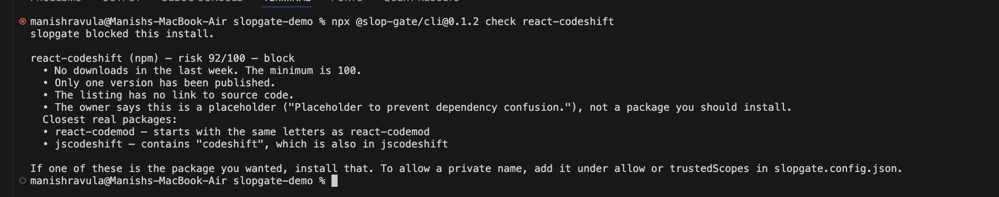
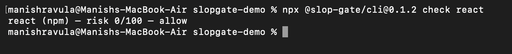
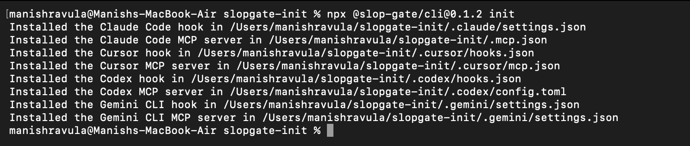
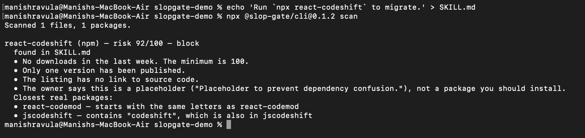
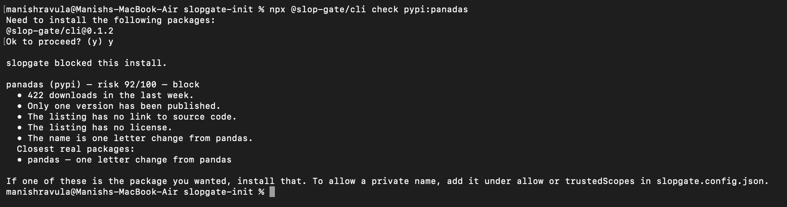
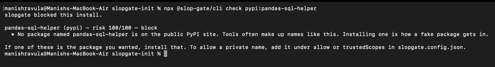
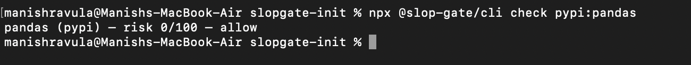

# slopgate

[](https://www.npmjs.com/package/@slop-gate/cli)
[](https://www.npmjs.com/package/@slop-gate/cli)
[](https://github.com/manishreddy998/slopgate/actions/workflows/ci.yml)
[](LICENSE)

Stop a coding agent before it installs a package that does not exist.

Agents invent dependency names, mistype real ones, and copy `npx` commands out of generated skill files. slopgate checks the name before the install. A missing package is blocked. A newly published name, an unused name, or a lookalike of a popular package is returned with a risk score and a short explanation.


## Quick start

```bash
npx @slop-gate/cli init
```

`init` installs a pre-install hook for Claude Code, Cursor, Codex CLI, and Gemini CLI, and registers an MCP server that exposes `check_package`.

```bash
npx @slop-gate/cli check react-codeshift
npx @slop-gate/cli check react
npx @slop-gate/cli scan
```

Install the package globally when you want the short `slopgate` command:

```bash
npm i -g @slop-gate/cli
slopgate check react
```

No telemetry. Registry requests stay between you and the registry.

### Blocked install



### Allowed install



### Client setup



### Repository scan



### Python packages

slopgate checks PyPI names before `pip`, `uv`, or `poetry` installs them. `panadas` is a one-letter lookalike of `pandas` with one release, no source link, and no license:



A name that is not on PyPI at all is blocked:



A real package passes:



Recorded from `@slop-gate/cli` 0.1.2 against the public npm and PyPI registries on 13 October 2026. `check` exits 1 on a block. The Claude Code hook prints `permissionDecision: deny` and exits 0, which is the deny signal that client expects. `npm install react` is allowed. The same check transcript is in [docs/demo-check.txt](docs/demo-check.txt).

## Why `react-codeshift` is blocked

In October 2025, generated skill files started telling agents to run `npx react-codeshift`. The name is a blend of [jscodeshift](https://www.npmjs.com/package/jscodeshift) and [react-codemod](https://www.npmjs.com/package/react-codemod). It was not a package. The command spread with those files, including through `bunx`, `pnpm dlx`, and `yarn dlx`.

On 14 January 2026, Charlie Eriksen at Aikido published a placeholder so the name could not be claimed later. On 13 October 2026 that placeholder had one version, no weekly downloads, no repository, and a description that says it exists to prevent dependency confusion. slopgate scores it 92/100 and blocks it from those facts. The name is not hard-coded. Background: [Agent skills spreading hallucinated npx commands](https://www.aikido.dev/blog/agent-skills-spreading-hallucinated-npx-commands).

`examples/bad-skill/SKILL.md` is a fixture of that kind. A scan of this repository reports it on purpose. CI ignores the README and `examples/` so the fixture does not fail the build.

## Install hooks

`init` installs a pre-install check:

| Client | Project file | When it runs |
| --- | --- | --- |
| Claude Code | `.claude/settings.json` | `PreToolUse` on Bash |
| Cursor | `.cursor/hooks.json` | `beforeShellExecution` |
| Codex CLI | `.codex/hooks.json` | `PreToolUse` on Bash |
| Gemini CLI | `.gemini/settings.json` | `BeforeTool` on `run_shell_command` |

`init` also registers an MCP server that exposes `check_package`, unless you pass `--no-mcp`. `--global` writes the user-level files. `--only cursor` limits setup to one client.

Supported install commands are `npm`, `pnpm`, `yarn`, `bun`, `npx`, `pip`, `uv`, `uvx`, `poetry`, `cargo`, and `go get`, including versions, scopes, flags, requirement files, and `&&` chains. `npm test` and a bare `npm install` (no new names) are ignored.

The hook fails open if slopgate crashes, so a bug does not stall the client. Set `SLOPGATE_FAIL_CLOSED=1` to fail closed instead.

## Scan a repository

```bash
npx @slop-gate/cli scan
npx @slop-gate/cli scan . --ignore examples --ignore README.md
```

The scan reads README files, `docs/**/*.md`, `SKILL.md`, `skills/**/*.md`, `CLAUDE.md`, `AGENTS.md`, `.cursor/rules`, `package.json`, `requirements*.txt`, `pyproject.toml`, `Pipfile`, `Cargo.toml`, and `go.mod`. It skips `node_modules`, `.git`, `dist`, `vendor`, virtualenvs, and Cargo `target`.

Use the composite action from this repository:

```yaml
name: slopgate
on: [pull_request]
jobs:
  scan:
    runs-on: ubuntu-latest
    steps:
      - uses: actions/checkout@v4
      - uses: manishreddy998/slopgate@main
        with:
          ignore: |
            examples
            README.md
```

`strict: true` also fails the job on warnings. The action builds slopgate from the action checkout, then scans the repository.

## Scoring

A confirmed miss on the public registry is a block. Other signals add up to a score from 0 to 100. The defaults block at 60 and warn at 25.

| Signal | Meaning |
| --- | --- |
| Age under 30 days | Published recently |
| Weekly downloads under 100 | Almost no install traffic |
| A single published version | No release history |
| Missing repository, description, or license | Thin metadata |
| Placeholder wording | The owner says not to install it |
| npm `preinstall`, `install`, or `postinstall` | Code runs at install time |
| Edit distance, homoglyphs, or separator changes | Close to a popular package |

Suggestions name the likely intended package. A weak token overlap, such as sharing `codeshift`, is explained and does not raise the score by itself, so `react-dom` is not flagged for containing `react`.

Popular packages score 0 even when they ship install scripts. `esbuild` is allowed. A git URL, a path, or a private registry is a warning when the public index misses, not a block. Names on `allow` or `trustedScopes` are allowed even if the public registry has never seen them.

If the registry cannot be reached, a popular name is allowed, a strong typo is blocked, and every other name follows `offline` (default `warn`). Fresh results are cached for 12 hours under `$XDG_CACHE_HOME/slopgate` or `~/.cache/slopgate`. A miss is cached for 15 minutes.

Copy [slopgate.config.example.json](slopgate.config.example.json) to `slopgate.config.json`, or set the same object on the `"slopgate"` key in `package.json`. `~/.config/slopgate/config.json` is merged after the project file. Numeric thresholds in the user file replace project values. Allow lists are unioned, so a project file can add an allow entry and the user file cannot remove it. A client that can edit the repo can edit the project file. Set `SLOPGATE_IGNORE_PROJECT_CONFIG=1` on the hook to ignore project config.

## Scope

slopgate does not audit the source of an already-popular package, and it does not query a vulnerability database. `npm install react` is allowed because react is a real, widely installed package. Socket, Snyk, and Aikido cover malware and known vulnerabilities after the name is legitimate.

| | slopgate | sloppy-joe | slopcop | Socket, Snyk, Aikido |
| --- | --- | --- | --- | --- |
| Install-time client hook | The clients in Install hooks, plus MCP | No, scan only | Wraps npm and pip | Commercial products |
| Registries | npm, PyPI, crates.io, Go | Eight ecosystems | npm and PyPI | Broad |
| Typos | Edit distance against a curated popular list | Generated typo variants | Name patterns | Threat intelligence |
| Known vulnerabilities | No | OSV | No | Yes |
| Price | Free, MIT | Free, Apache-2.0 | Free | Paid |

sloppy-joe goes further on generated typosquats and keeps its config outside the repo. slopgate is the zero-config hook: no runtime dependencies, and the client runs it before install.

## Commands

```bash
npx @slop-gate/cli init [--global] [--only claude,cursor,codex,gemini] [--no-install] [--no-mcp]
slopgate check react-codeshift
slopgate check pypi:flask cargo:serde go:github.com/gin-gonic/gin
slopgate hook --client claude
slopgate mcp
slopgate scan [dir] --ignore examples
```

`check --json` prints the score, reasons, and suggestions. `--strict` exits 1 on a warning as well as a block. `mcp` speaks JSON-RPC over stdio, with `Content-Length` framing or one JSON object per line.

## Development

Node 20 or newer. From a checkout:

```bash
git clone https://github.com/manishreddy998/slopgate.git
cd slopgate
npm install
npm test
npm run build
node dist/cli.js check react
```

See [CONTRIBUTING.md](CONTRIBUTING.md) for tests and [SECURITY.md](SECURITY.md) for fail-open behavior and project config.

MIT. Copyright 2026 Manish.
