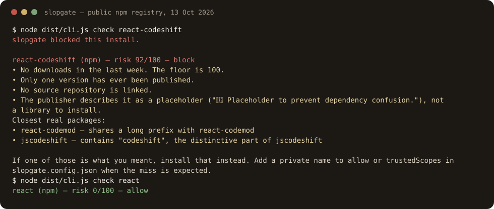

# slopgate

Stop an AI coding agent before it installs a package that isn't real.

Agents invent dependency names, mistype real ones, and copy `npx` lines out of generated skill files. slopgate sits in front of the install. A missing package is blocked. A brand-new, unused, or lookalike name comes back with a score and the popular package it resembles, in text the agent can read.

```bash
npx slopgate init
```

That one line is the install after this package is on npm. From a checkout of this repo:

```bash
npm install
npm run build
node dist/cli.js init
node dist/cli.js check react-codeshift
node dist/cli.js check react
```



Captured 13 October 2026 from the public npm registry. `check` exits 1 when it blocks. The Claude Code hook prints a deny decision and exits 0, which is how that client expects a block. `npm install react` is allowed. The same run is in [docs/demo-check.txt](docs/demo-check.txt).

No telemetry. Registry requests stay between you and the registry.

## The name agents actually installed

In October 2025, generated agent skills started telling agents to run `npx react-codeshift`. The name is a mash of [jscodeshift](https://www.npmjs.com/package/jscodeshift) and [react-codemod](https://www.npmjs.com/package/react-codemod). It was not a package. The command spread with those skill files into a lot of repositories, including through `bunx`, `pnpm dlx`, and `yarn dlx`.

On 14 January 2026, Charlie Eriksen at Aikido published a placeholder on that name so a later squatter could not take it. As of 13 October 2026 the placeholder has one version, no downloads that week, no source repository, and a description that says it exists to prevent dependency confusion. slopgate scores that listing at 92/100 and blocks it. The block comes from those facts, not from a hardcoded name. The write-up is [Agent skills spreading hallucinated npx commands](https://www.aikido.dev/blog/agent-skills-spreading-hallucinated-npx-commands).

`examples/bad-skill/SKILL.md` is that kind of file. Scanning this repository on purpose reports it. The same scan blocks `npx slopgate init` until this package is published, because that is an install of a name the registry does not have yet. CI ignores the README and `examples/` so those fixtures do not fail the build.

## What a hook sees

`init` wires a pre-install check for:

| Client | Project file | When it runs |
| --- | --- | --- |
| Claude Code | `.claude/settings.json` | `PreToolUse` on Bash |
| Cursor | `.cursor/hooks.json` | `beforeShellExecution` |
| Codex CLI | `.codex/hooks.json` | `PreToolUse` on Bash |
| Gemini CLI | `.gemini/settings.json` | `BeforeTool` on `run_shell_command` |

It also registers an MCP server with a `check_package` tool, unless you pass `--no-mcp`. Pass `--global` to write the user-level files, or `--only cursor` to touch one client.

The parsers cover `npm`, `pnpm`, `yarn`, `bun`, `npx`, `pip`, `uv`, `uvx`, `poetry`, `cargo`, and `go get`, including versions, scopes, flags, requirement files, and commands chained with `&&`. `npm test` and a bare `npm install` (no new names) are left alone.

If slopgate itself crashes, the hook fails open so a bug does not freeze the agent. Set `SLOPGATE_FAIL_CLOSED=1` when you would rather stop the install.

## Scan a repo

```bash
node dist/cli.js scan
node dist/cli.js scan . --ignore examples --ignore README.md
```

The scan reads README files, `docs/**/*.md`, `SKILL.md`, `skills/**/*.md`, `CLAUDE.md`, `AGENTS.md`, Cursor rules, `package.json`, `requirements*.txt`, `pyproject.toml`, `Pipfile`, `Cargo.toml`, and `go.mod`. It skips `node_modules`, `.git`, `dist`, `vendor`, virtualenvs, and Cargo `target`.

GitHub Actions, from the published repository:

```yaml
name: slopgate
on: [pull_request]
jobs:
  scan:
    runs-on: ubuntu-latest
    steps:
      - uses: actions/checkout@v4
      - uses: manishreddy998/slopgate@main
        with:
          ignore: |
            examples
            README.md
```

`strict: true` also fails the job on warnings. The action builds slopgate from the action directory, so it works before an npm publish.

## How a score is chosen

A confirmed miss on the public registry is a block. Everything else is a score from 0 to 100. The defaults block at 60 and warn at 25.

| Signal | What it means |
| --- | --- |
| Age under 30 days | The name was published very recently |
| Weekly downloads under 100 | Almost nobody is installing it |
| A single version | Nothing has been maintained yet |
| No repository, description, or license | The listing is thin |
| Placeholder wording | The owner says not to install it |
| Install scripts | `preinstall`, `install`, or `postinstall` on npm |
| Edit distance, homoglyphs, or a shuffled separator | Close to a popular package |

Suggestions are the likely real package. A weak resemblance, such as sharing the token `codeshift`, is explained and does not by itself raise the score, so `react-dom` is not flagged for containing `react`.

Popular packages score 0 even when they ship install scripts. `esbuild` is allowed. A git URL, a path, or a private registry is a warning when the public index misses, not a block. Names on `allow` or `trustedScopes` are allowed even when the registry has never heard of them.

When the registry cannot be reached, a popular name is allowed, a strong typo is blocked, and every other name follows `offline` (default `warn`). Lookups are cached for 12 hours under `$XDG_CACHE_HOME/slopgate` or `~/.cache/slopgate`. A miss is cached for 15 minutes.

Copy [slopgate.config.example.json](slopgate.config.example.json) to `slopgate.config.json`, or put the same object under a `"slopgate"` key in `package.json`. `~/.config/slopgate/config.json` is merged after that. Thresholds in the user file replace the project file. Allow lists are unioned, so a project file can add an allow and the user file cannot take it back. An agent that can edit the repo can edit the project file. Set `SLOPGATE_IGNORE_PROJECT_CONFIG=1` on the hook when the project file should not count.

## What this is not

slopgate does not audit a popular package for malware, known vulnerabilities, or a later compromised release. `npm install react` is allowed because react is a real, widely installed package. Socket, Snyk, and Aikido are the tools that follow a dependency after the name is legitimate.

| | slopgate | sloppy-joe | slopcop | Socket, Snyk, Aikido |
| --- | --- | --- | --- | --- |
| Stops the agent at install time | Claude, Cursor, Codex, Gemini, plus MCP | No, it scans | Wraps npm and pip | Commercial products |
| Registries | npm, PyPI, crates.io, Go | Eight ecosystems | npm and PyPI | Broad |
| Typos | Edit distance against a curated popular list | Generated typo variants | Name patterns | Threat intel |
| Known vulnerabilities | No | OSV | No | Yes |
| Price | Free, MIT | Free, Apache-2.0 | Free | Paid |

sloppy-joe goes deeper on typosquat generation and keeps its config outside the repo. slopgate's bet is the opposite shape: zero config, zero runtime dependencies, and a hook the agent cannot forget to run.

## Commands

```bash
slopgate init [--global] [--only claude,cursor,codex,gemini] [--no-install] [--no-mcp]
slopgate check react-codeshift
slopgate check pypi:flask cargo:serde go:github.com/gin-gonic/gin
slopgate hook --client claude          # used by the installed hooks
slopgate mcp                           # stdio MCP, Content-Length or newline JSON
slopgate scan [dir] --ignore examples
```

`check --json` prints the score, the reasons, and the suggestions. `--strict` exits 1 on a warning as well as a block.

## Development

Node 20 or newer. [CONTRIBUTING.md](CONTRIBUTING.md) has the test loop. [SECURITY.md](SECURITY.md) covers fail-open and project config.

MIT. Copyright 2026 Manish.
